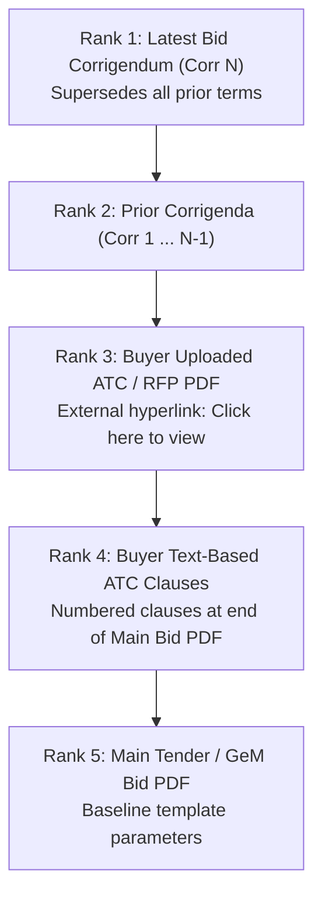

# TenderLens: Final Engineering Implementation Plan
**HackIIITD · Round 2 Product Execution Plan**  
*Team Traxo · Government Procurement AI*

---

## 1. Executive Summary & Synthesis

This document establishes the **Final Production Implementation Plan** for TenderLens, synthesized directly from:
1. **The Hackathon Presentation & Roles** (`TenderLens_Hackathon_Presentation.pptx`): Discover · Verify · Decide.
2. **Argon's Research & Strategic Analysis** ([`argon.md`](argon.md) & [`research/argon_report.md`](research/argon_report.md)): Indian procurement precedence hierarchy (DAG), the 5 material qualification traps, and TinyFish production configurations.
3. **The Shared Contract Specification** ([`contracts/schema.py`](contracts/schema.py)): Locked data models connecting Research, Backend, and Frontend.

---

## 2. Team Topology & Operational Boundaries

To eliminate merge conflicts and maintain velocity, each team member owns an isolated domain:

```
┌──────────────────────────────────────────────────────────────────────────────────────────┐
│                                  TENDERLENS PROJECT                                      │
├──────────────────────────────┬─────────────────────────────┬─────────────────────────────┤
│   MOHIT & ANTIGRAVITY        │           ARSHIT            │            ARGON            │
│   (Backend & Intelligence)   │      (Frontend & Data)      │     (Research & Evals)      │
├──────────────────────────────┼─────────────────────────────┼─────────────────────────────┤
│ • TinyFish Web Intelligence  │ • Next.js 14 Frontend UI    │ • 50-Tender GeM Benchmark   │
│   (TinySearch, Fetch, Agent) │ • Bidder Profile Onboarding │   Dataset (research/evals/) │
│ • Document Intelligence      │ • Interactive Scorecard UI  │ • Competitor Teardowns      │
│   (PyMuPDF + Hidden ATCs)    │ • PostgreSQL DB Schemas     │   (BidAssist, TrackTender)  │
│ • Deterministic Gatekeeper   │ • Redis Cache & Celery      │ • Evaluation of Precision,  │
│ • Semantic LLM Auditor       │ • MinIO / S3 Object Storage │   Recall, and ATC Capture   │
│ • FastAPI REST & SSE Backend │ • Docker Compose Infra      │                             │
└──────────────────────────────┴─────────────────────────────┴─────────────────────────────┘
```

> **The Boundary Principle**: Mohit & Antigravity build strictly in `backend/` and `scripts/`. Arshit consumes the FastAPI endpoints and renders the UI according to [`arshit-agents.md`](arshit-agents.md). Argon works strictly in `research/`.

---

## 3. Core Domain Mechanics: The Precedence DAG

Indian public procurement (GeM, CPPP, PSUs) distributes rules across multiple documents. Standard flat RAG fails because corrigenda and buyer ATCs explicitly supersede baseline terms.

TenderLens treats each tender as a **Versioned Directed Acyclic Graph (DAG)** with strict legal precedence:



### Precedence Resolution Engine:
1. Every extracted clause and threshold is tagged with:
   `(doc_id, precedence_rank, publication_timestamp, page_number, clause_id, verbatim_quote, bbox)`
2. When two clauses target the same canonical attribute (e.g., `min_annual_turnover` or `msme_turnover_relaxation`), **lower rank number ($Rank < Rank$) strictly overrides higher rank number**.
3. **Safe Uncertainty Rule**: If two clauses at the *same* rank conflict, or if a buyer ATC clause illegally contradicts overarching GeM General Terms and Conditions (GTC), the engine sets `status = "AMBIGUOUS_MANUAL_REVIEW"` and routes to human review.

---

## 4. Production Technical Architecture

```
                                    CLIENT LAYER
                             Next.js 14 Web Application
                            (Arshit · arshit-agents.md)
                                         │
                                         ▼ HTTP REST & SSE
 ┌────────────────────────────────────────────────────────────────────────────────────────┐
 │                              FASTAPI ORCHESTRATION LAYER                               │
 │                                (Mohit & Antigravity)                                   │
 ├────────────────────────────────────────────────────────────────────────────────────────┤
 │  POST /api/v1/tenders/search     POST /api/v1/tenders/fetch                            │
 │  POST /api/v1/audit/evaluate     GET  /api/v1/audit/stream/{task_id}                   │
 └───────┬───────────────────────────────────────────┬────────────────────────────┬───────┘
         │                                           │                            │
         ▼                                           ▼                            ▼
┌──────────────────┐                       ┌──────────────────┐         ┌─────────────────┐
│ WEB INTELLIGENCE │                       │   DOC INTELLIGENCE│         │ QUALIFICATION   │
│ (TinyFish Stack) │                       │  (Two-Tier Router│         │ ENGINE (Hybrid) │
├──────────────────┤                       ├──────────────────┤         ├─────────────────┤
│ 1. TinySearch    │                       │ Tier 1: PyMuPDF  │         │ 1. Deterministic│
│    include_domain│                       │ • 250+ pgs/sec   │         │    Gatekeeper   │
│    purpose query │                       │ • Hidden PDF     │         │    • Turnover   │
│ 2. TinyFetch     │                       │   hyperlinks     │         │    • MSE PPP2012│
│    Batch <= 10   │                       │   (get_links)    │         │    • EMD GFR170 │
│    d <= 2 queue  │                       │ • Bilingual clip │         │    • MII DPIIT  │
│    ETag/Modified │                       │ Tier 2: Docling  │         │    • MAF/Certs  │
│ 3. TinyAgent SSE │                       │ • TableFormer    │         │ 2. Semantic LLM │
│    Stealth max10 │                       │ • Cell bboxes    │         │    • Grounding  │
└──────────────────┘                       └──────────────────┘         └─────────────────┘
```

---

## 5. Detailed Engineering Modules (Our Scope)

### Module 1: Web Intelligence Layer (`backend/services/tinyfish_service.py`)
- **Stage 1 (TinySearch API)**:
  - Header: `X-API-Key: os.environ["TINYFISH_API_KEY"]`
  - Uses `include_domains="gem.gov.in,eprocure.gov.in,tenders.bhel.com,icmr.nic.in,etenders.hry.nic.in"`.
  - Avoids deprecated `site:` operators.
  - Dynamically constructs a `purpose` query (up to 2,000 chars) from `BidderProfile`.
  - Enforces mutual exclusivity: never mix `recency_minutes` with `after_date`.
- **Stage 2 (TinyFetch Recursive)**:
  - Stateless single-hop batching (max 10 URLs per request).
  - Implements the recursive queue in Python with depth limit $d \le 2$.
  - Preserves `etag` and `last_modified` headers for HTTP 304 TTL caching.
- **Stage 3 (TinyAgent Stealth SSE Fallback)**:
  - Triggered only when `TinyFetch` encounters `bot_blocked`, `login_required`, or empty content.
  - Cost circuit breaker: enforces `mode="strict"`, `max_steps=10`, `max_duration_seconds=60`.
  - Relays live SSE stream (`STARTED` $\rightarrow$ `STREAMING_URL` $\rightarrow$ `PROGRESS` $\rightarrow$ `COMPLETE`).

### Module 2: Document Intelligence Layer (`backend/services/document_processor.py`)
- **Tier 1 Fast Pass (`PyMuPDF` / `fitz`)**:
  - Extracts text at 250+ pages/second.
  - **Hidden Hyperlink Extraction**: Discovers `"Buyer uploaded ATC document: Click here to view the file"` from PDF annotation URI dictionaries via `page.get_links()` and pushes child URLs into the TinyFetch queue.
  - **Bilingual Column Isolation**: Uses bounding-box spatial clipping to separate Hindi and English columns.
- **Tier 2 Structural Pass (`Docling` / `TableFormer`)**:
  - Routes complex tabular grids or scanned annexures to Docling for cell coordinate reconstruction (`prov.bbox`, `prov.page_no`).

### Module 3: Deterministic Gatekeeper (`backend/engine/deterministic_gatekeeper.py`)
Pure Python logic enforcing statutory procurement rules (zero math hallucination):
1. **3-Year Average Turnover Gate**:
   - $\text{Avg} = (\text{Year}_1 + \text{Year}_2 + \text{Year}_3) / 3$
   - Applies Public Procurement Policy for MSEs Order, 2012 / GFR Rule 173(i) exemption unless explicitly overridden by an ATC/Corrigendum.
2. **Years of Experience / Past Performance Gate**:
   - Checks CPWD/GeM similar work thresholds ($1 \ge 80\%$, $2 \ge 50\%$, or $3 \ge 40\%$).
3. **EMD Exemption Gate**:
   - GFR 2017 Rule 170(i) exemption for registered MSEs and DPIIT-recognized Startups.
4. **Make in India (MII) Preference Gate**:
   - Class-I Local Supplier ($\ge 50\%$), Class-II Local Supplier ($20\% - 49\%$), Non-Local ($< 20\%$).
5. **OEM Authorization (MAF) Gate**:
   - Flags resellers/traders lacking mandatory manufacturer authorization letters.
6. **Mandatory Certifications Gate**:
   - Set-difference check ($C_{\text{missing}} = C_{\text{required}} \setminus C_{\text{held}}$) for ISO-9001, BIS, etc.

### Module 4: Semantic Clause Engine (`backend/engine/qualification_engine.py`)
- LLM structured extraction grounded in Precedence-tagged chunks.
- Computes final `QualificationScorecard` JSON conforming to [`contracts/schema.py`](contracts/schema.py):
  - `STRONG_BID` (4.0 – 5.0)
  - `CONDITIONAL_BID` (2.5 – 3.9)
  - `RED_FLAG_NO_BID` (0.0 – 2.4)

### Module 5: FastAPI Orchestrator (`backend/main.py`)
- `POST /api/v1/tenders/search`
- `POST /api/v1/tenders/fetch`
- `POST /api/v1/audit/evaluate`
- `GET /api/v1/audit/stream/{task_id}`

---

## 6. Execution Roadmap & Sprint Milestones

| Sprint Phase | Deliverables & Work Items | Responsible |
| :--- | :--- | :--- |
| **Phase 1: Setup & Contracts** | • UV environment & Python 3.12 pinned<br>• Locked `contracts/schema.py`<br>• Playwright extraction of Argon's report<br>• Agent memory logs (`MOhit-Agents.md`, `arshit-agents.md`) | Mohit & Antigravity |
| **Phase 2: Backend Dependencies & Services** | • `uv add fastapi uvicorn httpx pymupdf pydantic-settings python-dotenv sse-starlette`<br>• Build `backend/services/tinyfish_service.py`<br>• Build `backend/services/document_processor.py` | Mohit & Antigravity |
| **Phase 3: Qualification Engine** | • Build `backend/engine/deterministic_gatekeeper.py`<br>• Build `backend/engine/qualification_engine.py`<br>• Unit tests for turnover, MSME exemptions, and EMD rules | Mohit & Antigravity |
| **Phase 4: API Wiring & Live Streaming** | • Build `backend/main.py` with CORS & SSE endpoints<br>• Connect TinyAgent SSE stream to `/audit/stream/{task_id}` | Mohit & Antigravity |
| **Phase 5: Evaluation & Demo** | • Run 50-tender GeM benchmark in `research/evals/`<br>• Validate $\ge 85\%$ precision and $\ge 80\%$ recall<br>• Record end-to-end demo video for Round 2 pitch | All (Traxo Team) |

---
*Created for Team Traxo · TenderLens · HackIIITD Round 2*
